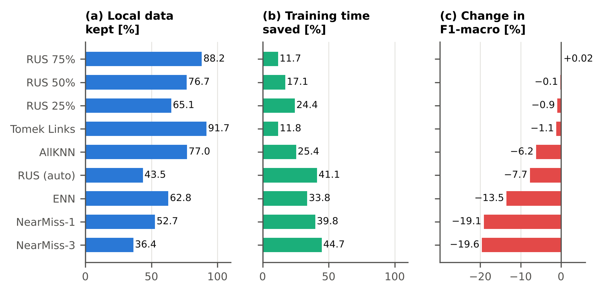

# Local undersampling in federated learning with tree-based learners

[](requirements-experiment.txt)
[](LICENSE)
[](datasets/README.md)
[](docs/results.md)

Code, data, raw results and analysis scripts for the paper

> Veronika Pieper, Ireneusz Czarnowski. **Tree-based Local Learners in Federated Learning with Local Undersampling:
> A Multi-Algorithm Empirical Study across Nine Tabular Benchmarks.** Department of Information Systems, Gdynia
> Maritime University, Gdynia, Poland. Manuscript in preparation, 2026.

Undersampling the majority classes on each client of a federation rebalances the local data and shortens local
training, but, to our knowledge, its effect on federations of tree-based learners had not been measured systematically.
This repository holds a full factorial experiment that measures it: 86 400 one-shot federated runs on nine public tabular data sets, with nine
undersampling methods and a baseline, four learners, six aggregation rules and 3 to 10 clients. Every table and figure of
the paper can be regenerated from the stored results; re-running the federated experiment itself, which takes several
days on a laptop, is optional.

## Contents

1. [Main findings](#main-findings)
2. [The experiment at a glance](#the-experiment-at-a-glance)
3. [Repository structure](#repository-structure)
4. [Quick start](#quick-start)
5. [Data](#data)
6. [Documentation](#documentation)
7. [Citation](#citation)
8. [Licence and authors](#licence-and-authors)

## Main findings

Values are differences in mean test F1-macro over matched runs, in %.

- **The data set and the undersampling method dominate.** The data set explains the largest share of the variance of
  test F1-macro (omega^2 = 0.481), followed by the undersampling method (0.188) and their interaction (0.160).
- **Mild random undersampling is safe.** Keeping 75% or 50% of the largest class changes F1-macro by +0.02% and -0.12%
  and shortens local training by 12% and 17%.
- **Several common methods are harmful on clients.** ENN, AllKNN, NearMiss-1, NearMiss-3 and random undersampling to
  the size of the smallest class lower F1-macro by 6% to 20% on average and by up to 45% on single data sets. Depending
  on the method, very little data remains on a client, the majority classes are represented only by the instances
  closest to the minority class, or small and overlapping classes are erased.
- **The data set decides how much a harmful method costs:** on average over the five harmful methods, from 3.9%
  (Letter Recognition) to 28.7% (Car Evaluation).
- **The aggregation rule hardly matters** (omega^2 = 0.0002), and none of its interactions with the other elements
  exceeds omega^2 = 0.0001.
- **Undersample after the split, on training data only.** Undersampling the whole data set before the cross-validation
  split also undersamples the test data and would have shown ENN 6.0% above the baseline instead of 13.5% below it.

<p align="center">
  
</p>

| Undersampling method | Change in F1-macro (95% CI) | Local data kept | Local training time saved |
| --- | --- | --- | --- |
| RUS 75% (keeps 75% of the largest class) | +0.02% (-0.3 to +0.3) | 88.2% | 12% |
| RUS 50% (keeps 50% of the largest class) | -0.12% (-0.6 to +0.3) | 76.7% | 17% |
| RUS 25% (keeps 25% of the largest class) | -0.9% (-1.9 to +0.1) | 65.1% | 24% |
| Tomek Links | -1.1% (-2.2 to -0.3) | 91.7% | 12% |
| AllKNN | -6.2% (-10.4 to -3.3) | 77.0% | 25% |
| RUS (auto: every class reduced to the size of the smallest) | -7.7% (-14.3 to -2.2) | 43.5% | 41% |
| ENN (Edited Nearest Neighbours) | -13.5% (-21.5 to -6.7) | 62.8% | 34% |
| NearMiss-1 | -19.1% (-28.6 to -9.8) | 52.7% | 40% |
| NearMiss-3 | -19.6% (-28.8 to -10.8) | 36.4% | 45% |

Baseline without undersampling: mean test F1-macro 82.2%. All columns are averages over the nine data sets: the change
in F1-macro is the mean difference to the baseline over matched runs with its 95% cluster-bootstrap confidence interval,
the data kept is the share of the local training data that remains on a client, and the time saved is 1 minus the ratio
of the training times in matched FedAvg runs (median per data set). Sources:
[`results/table_us_methods.csv`](results/table_us_methods.csv) (also with the Holm-adjusted p-values) and
[`results/us_audit_per_dataset.csv`](results/us_audit_per_dataset.csv).

## The experiment at a glance

**Protocol.** One-shot federated learning with aggregation in probability space. In each cross-validation fold, the
training part is split into K stratified client sets. Each client applies one undersampling method to its own data (or
none), trains one local model and outputs class-probability vectors for the validation and test inputs. The server
combines the K vectors with an aggregation rule and predicts the class with the highest combined probability. Only
probability vectors leave the clients, and validation and test data are never undersampled.

| Element | Levels |
| --- | --- |
| Data set | 9 public tabular data sets, imbalance ratio 1.1 to 3381 |
| Undersampling on each client | none (baseline), RUS (auto), RUS 75%, RUS 50%, RUS 25%, NearMiss-1, NearMiss-3, ENN, AllKNN, Tomek Links |
| Local learner | decision tree, random forest, gradient boosting, XGBoost (fixed hyperparameters) |
| Aggregation rule | FedAvg, WeightedFedAvg, FedMedian, FedTrimmedMean, FedProx (distance-weighted mean), FedBoost (rank-weighted mean) |
| Number of clients K | 3, 4, ..., 10 |
| Evaluation | stratified 5-fold cross-validation; the held-out fold is split 50/50 into validation and test |

9 x 10 x 4 x 6 x 8 x 5 = 86 400 runs. Primary metric: test F1-macro; accuracy, macro precision and recall, AUC-ROC and
the local training time are recorded too. The statistical analysis uses a factorial ANOVA (omega^2), Friedman and
Nemenyi tests over the data sets, Wilcoxon signed-rank tests with Holm correction and cluster-bootstrap confidence
intervals. Every element, the exact definitions of the methods and rules, and the seeds are described in
[docs/experiment.md](docs/experiment.md).

## Repository structure

```
README.md                      this page
LICENSE                        MIT License (code)
CITATION.cff                   citation metadata ("Cite this repository" on GitHub)
requirements-experiment.txt    packages of the experiment, as run
requirements-analysis.txt      additional packages for the analysis
datasets/                      eight of the nine data sets as obtained from their sources (one zip each), licences
tools/
    unpack_datasets.py             unpacks datasets/*.zip into datasets_original/, where the code expects them
    reproduce_all.py               regenerates every table and figure, then compares them with the published ones
    compare_with_published.py      compares the tables re-created in analysis/ with those in results/
    run_windows_order.py           runs a split script with the file order of the original Windows run
src/original/                  exact code that produced results/fl_results_raw.csv
    federated_data_split.py        baseline split: 5-fold CV, validation/test halves, K = 3..10 stratified clients
    federated_data_split_path1.py  path 1: undersampling of the whole data set before the CV split (excluded)
    federated_data_split_path2.py  path 2: undersampling on each client after the split (analysed)
    fl_training.py                 local training (DT, RF, GB, XGB) and one-shot probability aggregation
src/fixed/                     the same scripts with the known issues corrected
patches/                       unified diffs from src/original/ to src/fixed/
analysis/                      statistics, client audit, reproduction check and figures
results/                       raw (235 200 runs) and analysed (86 400 runs) results, statistics, audits
figures/                       all 30 figures of the paper as PDF (vector) and PNG (300 dpi)
docs/                          detailed documentation
```

## Quick start

**Install** (Python 3.11 or newer; the experiment ran on Python 3.11 under Windows and the check on Python 3.13 under
Linux):

```bash
git clone https://github.com/VeRonikARoNik/fl-local-undersampling.git
cd fl-local-undersampling
python -m venv .venv
source .venv/bin/activate          # Windows: .venv\Scripts\activate
pip install -r requirements-experiment.txt -r requirements-analysis.txt
```

**Explore the results.** The analysed runs are one table with one row per run:

```python
import pandas as pd

runs = pd.read_csv("results/fl_results_clean.csv")
print(runs.groupby("us_method").test_f1_macro.mean().mul(100).round(2))
```

**Regenerate every table and figure of the paper** from the stored results, without re-running the experiment, and
compare them with the published versions:

```bash
python tools/reproduce_all.py
```

This takes about 10 minutes and ends with `Tables compared: 57, different: 0`. Tables are written to `analysis/` and
figures to `analysis/figures/`, so the published versions in `results/` and `figures/` stay untouched. The step by step
version is in [docs/reproduce.md](docs/reproduce.md#regenerate-the-tables-and-figures).

**Re-run the experiment** (optional, several days on a laptop): unpack the data sets with
`python tools/unpack_datasets.py`, add UNSW-NB15 (see [datasets/README.md](datasets/README.md)) and follow
[docs/reproduce.md](docs/reproduce.md#re-run-the-federated-experiment).

## Data

All nine data sets are public. Eight of them are in [`datasets/`](datasets) as obtained from their sources; UNSW-NB15
has to be downloaded from its source, because its terms do not cover redistribution.

| Code | Data set | Instances | Classes | IR | Source |
| --- | --- | --- | --- | --- | --- |
| UNSW | UNSW-NB15 | 257 673 | 2 | 1.8 | UNSW Canberra (download separately) |
| RT | RT-IoT2022 | 123 117 | 12 | 3381 | UCI |
| LR | Letter Recognition | 20 000 | 26 | 1.1 | UCI |
| DRY | Dry Bean | 13 611 | 7 | 6.8 | UCI |
| CM | Crowdsourced Mapping | 10 845 | 6 | 75.1 | UCI |
| SLS | Statlog (Landsat Satellite) | 6 435 | 6 | 2.4 | UCI |
| CAR | Car Evaluation | 1 728 | 4 | 18.6 | UCI |
| SVS | Statlog (Vehicle Silhouettes) | 846 | 4 | 1.1 | UCI |
| AIH | Avian influenza A(H5N1) in humans, line list | 294 | 4 | 9.2 | Robert Koch Institute |

IR is the imbalance ratio (largest class divided by the smallest). Features, DOIs and licences are listed in
[datasets/README.md](datasets/README.md). Please cite the original sources when you reuse the data sets.

## Documentation

| Page | Content |
| --- | --- |
| [Design of the experiment](docs/experiment.md) | protocol, undersampling methods, learners, aggregation rules, stages, the three paths, seeds |
| [Reproducing the results](docs/reproduce.md) | installation, regenerating every table and figure, re-running the experiment, reproduction check |
| [Result files](docs/results.md) | columns of the run files, derived results, client audit |
| [Analysis scripts](docs/analysis-scripts.md) | what every script produces, environment variables |
| [Figures](docs/figures.md) | every figure of the paper with its file and script |
| [Known issues](docs/known-issues.md) | issues in the original code and their fixes, excluded conditions, limitations |
| [Data sets](datasets/README.md) | sources, licences, preparation, unpacking |

**Known issues in short.** The original training script scored 360 runs incorrectly when undersampling removed a class
from every client; these runs were re-scored, and the analysed results use the corrected values. Undersampling before
the cross-validation split (path 1), the Neighbourhood Cleaning Rule and Soybean (Large) are excluded from the analysis,
and FedBagging is merged with FedAvg. `src/original/` keeps the code exactly as it ran; `src/fixed/` and `patches/` hold
the corrections. Details in [docs/known-issues.md](docs/known-issues.md).

## Citation

If you use this code, these results or the prepared data, please cite the paper:

```bibtex
@unpublished{Pieper2026LocalUndersamplingFL,
  author = {Pieper, Veronika and Czarnowski, Ireneusz},
  title  = {Tree-based Local Learners in Federated Learning with Local Undersampling:
            A Multi-Algorithm Empirical Study across Nine Tabular Benchmarks},
  note   = {Manuscript in preparation},
  year   = {2026}
}
```

GitHub shows the same reference under "Cite this repository" (from [`CITATION.cff`](CITATION.cff)).

## Licence and authors

Code: MIT License (see [`LICENSE`](LICENSE)). Data sets: the licences of their original sources (see
[datasets/README.md](datasets/README.md)).

Veronika Pieper and Ireneusz Czarnowski, Department of Information Systems, Gdynia Maritime University, Gdynia, Poland.
Questions: please open an issue in this repository or contact the corresponding author of the paper.
