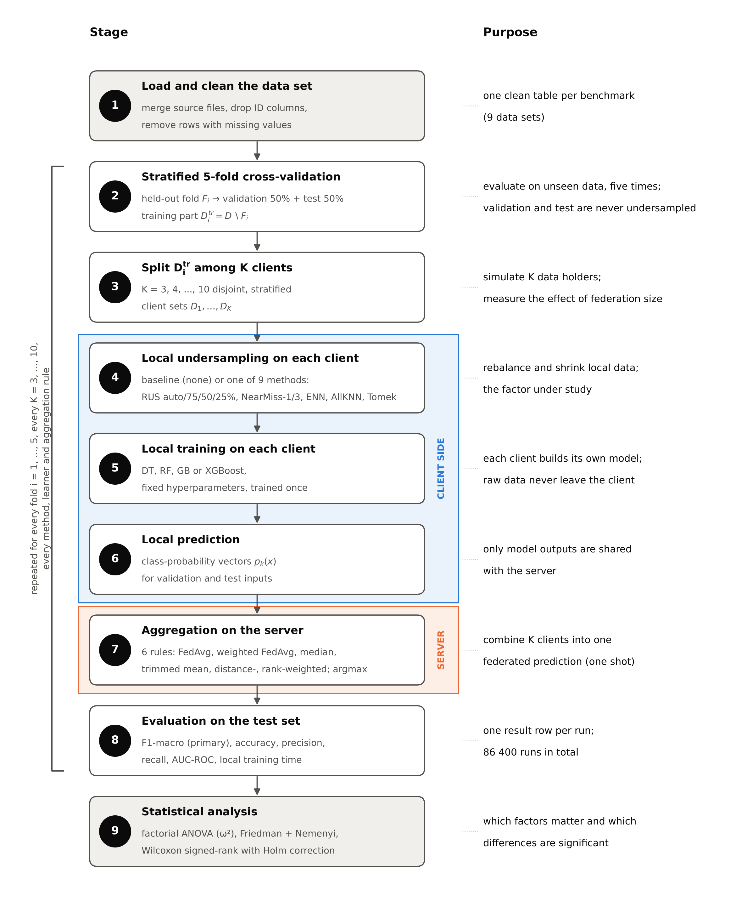

# Design of the experiment

[Back to the documentation index](README.md)

## The question

Federated learning (FL) on tabular data often meets two obstacles at once: class imbalance on the clients and the cost
of local training. Undersampling the majority classes on each client addresses both, but its effect in federations of
tree-based learners had not been measured systematically. The study asks:

- whether undersampling applied independently on each client preserves the predictive quality of one-shot federated
  ensembles of tree-based learners;
- how this effect depends on the undersampling method, the local learner, the aggregation rule and the number of
  clients;
- how these elements affect each other, including the moment at which undersampling is applied.

## Protocol

One-shot federated learning with aggregation in probability space. In each cross-validation fold, the training part is
split into K stratified client sets. Each client applies one undersampling method to its own data (or none), trains one
local model and outputs class-probability vectors for the validation and test inputs. The server combines the K vectors
with an aggregation rule and predicts the class with the highest combined probability. Each local model is trained once
and only probability vectors leave the clients. Validation and test data are never undersampled.

  

## Elements of the study

| Element | Levels |
| --- | --- |
| Data set | 9 public tabular data sets, imbalance ratio 1.1 to 3381 (see [the data sets](../datasets/README.md)) |
| Undersampling on each client | none (baseline), RUS (auto), RUS 75%, RUS 50%, RUS 25%, NearMiss-1, NearMiss-3, ENN, AllKNN, Tomek Links (imbalanced-learn 0.14.1) |
| Local learner | decision tree (DT), random forest (RF), gradient boosting (GB), XGBoost (XGB), with fixed hyperparameters |
| Aggregation rule (FL method) | FedAvg, WeightedFedAvg, FedMedian, FedTrimmedMean, FedProx, FedBoost (definitions below) |
| Number of clients K | 3, 4, ..., 10 |
| Evaluation | stratified 5-fold cross-validation; the held-out fold is split 50/50 into a validation and a test half |

The full factorial design gives 9 x 10 x 4 x 6 x 8 x 5 = 86 400 runs. The primary metric is test F1-macro; accuracy,
macro precision and recall, AUC-ROC and the local training time are recorded as well.

### Undersampling methods

All samplers come from imbalanced-learn 0.14.1, with their default parameters unless stated, and are applied to the
training data of one client at a time (function `apply_undersampling` in `src/*/federated_data_split_path2.py`).

| Code in results | Method | What it does on a client |
| --- | --- | --- |
| `none` | baseline | no undersampling |
| `RUS` | random undersampling, `sampling_strategy="auto"` | every class is reduced at random to the size of the smallest class |
| `RUS75`, `RUS50`, `RUS25` | random undersampling with a ratio | only the largest class is reduced at random, to 75%, 50% or 25% of its size; the other classes are kept |
| `NearMiss` | NearMiss-1 | keeps the instances of the larger classes with the smallest mean distance to their nearest instances of the smallest class |
| `NM3` | NearMiss-3 | keeps instances of the larger classes taken from the neighbourhoods of the instances of the smallest class |
| `ENN` | Edited Nearest Neighbours | removes instances of the larger classes whose nearest neighbours do not all share their class |
| `AllKNN` | AllKNN | applies ENN repeatedly with a growing number of neighbours |
| `TomekLinks` | Tomek Links | removes the instances of the larger classes that form Tomek links (pairs of mutual nearest neighbours from different classes) |

When a client holds fewer than two classes or fewer than four instances, or the sampler fails (for example when a
class has fewer instances than the sampler needs neighbours), the client keeps its data; these fallbacks are counted in
the [client audit](results.md#client-audit).

### Local learners

| Code | Learner | Hyperparameters |
| --- | --- | --- |
| `DT` | `DecisionTreeClassifier` (scikit-learn 1.8.0) | `max_depth=10` |
| `RF` | `RandomForestClassifier` | `n_estimators=100`, `n_jobs=-1` |
| `GB` | `GradientBoostingClassifier` | `n_estimators=100`, `learning_rate=0.1` |
| `XGB` | `XGBClassifier` (xgboost 3.2.0) | `n_estimators=100`, `learning_rate=0.1`, `max_depth=6`, `eval_metric="mlogloss"`, `n_jobs=-1` |

All other hyperparameters keep their library defaults. The local model of client k uses the seed 42 + (k - 1).

### Aggregation rules

Each client k returns a matrix $P_k$ of class probabilities (one row per validation or test instance). The server
combines the K matrices and predicts the class with the highest combined probability.

| Code | Rule | Combined probability |
| --- | --- | --- |
| `FedAvg` | mean | $\frac{1}{K}\sum_k P_k$ |
| `WeightedFedAvg` | mean weighted by the client size after undersampling | $\sum_k \frac{n_k}{\sum_j n_j} P_k$ |
| `FedMedian` | coordinate-wise median | median of the K values of every entry |
| `FedTrimmedMean` | coordinate-wise trimmed mean | the lowest and the highest of the K values of every entry are dropped (trim fraction 0.1, at least one value on each side), the rest is averaged |
| `FedProx` | distance-weighted mean | weights proportional to $1/(1 + \mu \lVert P_k - \bar P \rVert_F)$ with $\mu = 0.01$ and $\bar P$ the mean of the K matrices |
| `FedBoost` | rank-weighted mean | weight $2k / (K(K + 1))$ for client k; a control rule whose weights are unrelated to client quality |

The names FedProx and FedBoost are the names used in the code and in the result files. In this one-shot protocol they
denote the weighted means above, not the iterative algorithms of the same names. The raw results also contain
`FedBagging`, which is soft voting with equal weights and therefore numerically identical to FedAvg; it is merged with
FedAvg in the analysis.

## Stages

1. Data preparation: read and merge the source files, remove identifier columns, columns that reveal the label and rows
   with missing values.
2. Cross-validation and evaluation split.
3. Client partition into K stratified client sets.
4. Local undersampling on each client (or none).
5. Local training.
6. Local prediction: class-probability vectors for the validation and test inputs.
7. Aggregation on the server.
8. Evaluation.
9. Statistical analysis: factorial ANOVA (type II sums of squares, effect size omega^2), Friedman test with the
   Iman-Davenport correction and Nemenyi post hoc test with the data sets as units, Wilcoxon signed-rank tests with Holm
   correction and the rank-biserial correlation, cluster-bootstrap confidence intervals.

## Three paths of the original experiment

The original run produced three paths that differ in the moment of undersampling.

| Path (`path_type`) | Undersampling | In the paper |
| --- | --- | --- |
| 1 (`us_before`) | the whole data set, before the cross-validation split, so the validation and test halves are undersampled too | excluded from the main analysis; Section 8.5 shows it as a pitfall |
| 2 (`us_after`) | each client, on its own training data, after the split and the client partition | analysed |
| 3 (`baseline`) | none | analysed (reference) |

## Seeds

| Step | Seed |
| --- | --- |
| 5-fold cross-validation | 42 |
| validation/test split of fold i | 42 + i |
| client partition | 42 + 10 * fold + K |
| undersampling on a client | 42 + 100 * fold + 10 * K + client |
| local model of client k | 42 + (k - 1) |

Neighbourhood-based undersamplers and gradient boosting resolve ties in a way that depends on the compiled code, so a
re-run on another system can differ in single runs. See [known issues](known-issues.md) and the reproduction check in
[results](results.md#reproduction-check).
